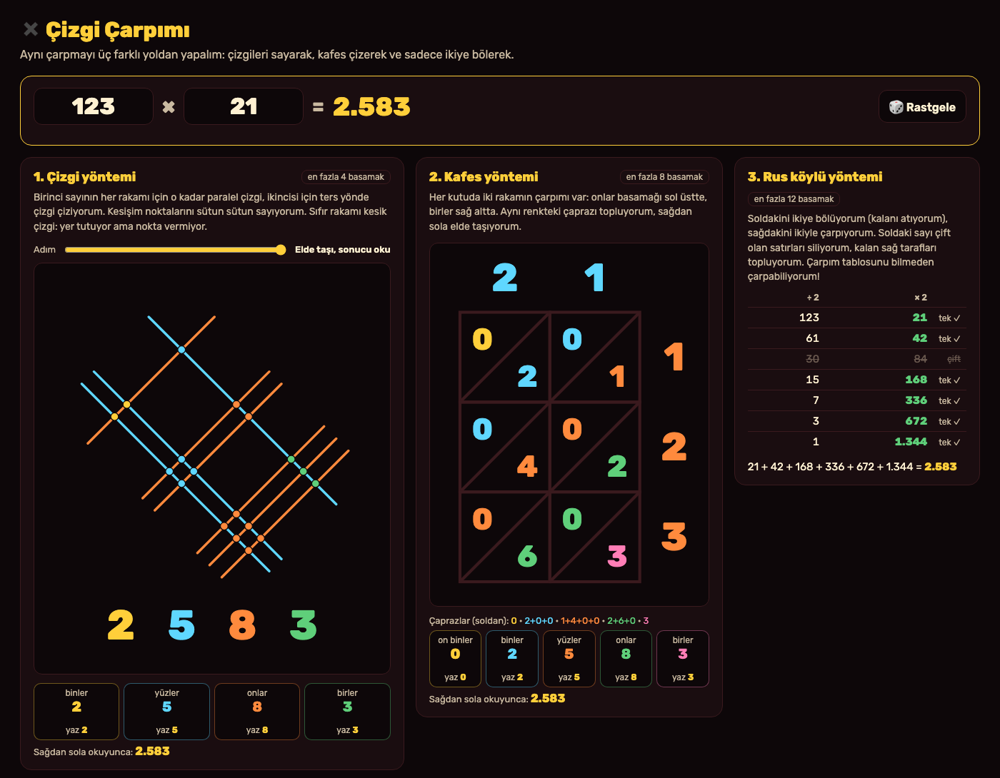
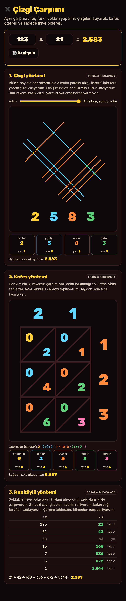

# Çizgi Çarpımı

Aklıma bu geldi: Bugün Reddit'te "Mind blown multiplication" (akıl almaz çarpma) diye bir gönderi vardı. Başlığı görünce, çizgiler çizip kesişim noktalarını sayarak çarpma yapılan yöntem aklıma geldi. Ben "bu gerçekten her sayıda çalışıyor mu?" diye merak ettim. Okulda bize hep alt alta çarpmayı öğretiyorlar ama aynı çarpmayı yapmanın başka yolları da var. Ben bu aracı bunun için yaptım. İki sayı yazıyorum, aynı çarpma üç farklı yoldan adım adım yapılıyor: **çizgileri sayarak**, **kafes çizerek** ve **sadece ikiye bölüp ikiyle çarparak**. Bu iki resim, benim çalıştırdığım uygulamanın gerçek ekranları.

## Ben nasıl kullanıyorum?

1. Ben bu klasörde `python3 -m http.server 8000` çalıştırıyorum. Sonra `http://localhost:8000` açıyorum.
2. Ben üstteki iki kutuya sayıları yazıyorum. Sonuç hemen yanında çıkıyor. **🎲 Rastgele** ile kendime soru da sorabiliyorum.
3. Ben **Çizgi yöntemi** kartında **Adım** kaydırıcısıyla çizimi adım adım açıyorum: önce birinci sayının çizgileri, sonra ikincinin, sonra kesişim noktaları, sonra sütun sayıları, en son elde.
4. Ben **Kafes yöntemi** kartında her kutudaki çarpımı ve aynı renkli çaprazların toplamını görüyorum.
5. Ben **Rus köylü yöntemi** kartında ikiye bölme tablosunu görüyorum. Çift satırlar siliniyor, kalanlar toplanıyor.

Çizgi yöntemi en fazla 4 basamağa kadar, kafes 8, Rus köylü yöntemi 12 basamağa kadar çalışıyor. Daha büyük sayılarda çizim birbirine karışıyor.

## Ben bu yöntemleri nasıl anladım?

**1. Çizgi yöntemi (Japon ya da Maya çarpması diye de geçiyor).** 123 × 21'de 1, 2 ve 3 için turuncu çizgi demetleri, 2 ve 1 için ters yönde mavi demetler çiziyorum. Her kesişim noktası iki rakamın çarpımındaki bir "1". Aynı sütuna düşen noktalar aynı basamağa ait. Soldan sağa 2 · 5 · 8 · 3 nokta sayılıyor, sonuç 2583. Bir sütunda 10 ya da daha fazla nokta varsa elde soldaki sütuna geçiyor. **Sıfır rakamı** bir sorun: sıfır tane çizgi çizilemez. Ben sıfırı kesik tek bir çizgiyle gösteriyorum. Yer tutuyor ama hiç nokta vermiyor.

**2. Kafes yöntemi (Gelosia).** Rakamları bir ızgaraya diziyorum. Her kutuya iki rakamın çarpımını yazıyorum: onlar basamağı sol üstte, birler sağ altta. Aynı çapraza düşen sayılar aynı basamak oluyor. Sağdan başlayıp çaprazları topluyorum ve eldeyi sola taşıyorum.

**3. Rus köylü yöntemi.** Soldaki sayıyı ikiye bölüyorum (kalanı atıyorum), sağdakini ikiyle çarpıyorum. Soldaki sayı tek olan satırların sağ taraflarını topluyorum. Bunun çalışmasının sebebi, sayıyı **ikilik sistemde** yazmak. 123 = 64 + 32 + 16 + 8 + 2 + 1. Tek olan satırlar tam olarak bu ikinin kuvvetleri. Bu yüzden çarpım tablosunu hiç bilmeden çarpabiliyorum.

## Ben içeride ne yaptım?

Çizgi yönteminde önce düz bir ızgara kurdum: birinci sayının çizgileri yatay, ikincinin dikey. Sonra her şeyi **45° döndürdüm**. Döndürünce aynı basamağın kesişimleri tam aynı sütuna düşüyor, çünkü yeni yatay konum `(x + y) / √2` oluyor.

İlk denememde demetler arası mesafeyi sabit 6 birim yapmıştım. Ama 9 rakamının 9 çizgisi 8 birim yer kaplıyor, yan demete taşıyordu. Şimdi mesafeyi en büyük rakama göre hesaplıyorum.

Üç yöntemin de sonunda aynı **elde zinciri** var: en sağdaki basamaktan başlıyorum, 10'u geçeni sola taşıyorum. Ben bunu tek bir fonksiyonda yazdım, üç yöntem de onu kullanıyor.

Büyük sayılarda JavaScript'in normal sayıları hata yapıyor. 99.999.999 × 99.999.999 doğru çıkmıyor. Ben sonuçları ve Rus köylü yöntemini **BigInt** ile hesapladım.

Ben `core.mjs` içinde yöntemleri, `app.mjs` içinde çizimi tuttum. Çizimler SVG. Hiçbir sunucu, hesap ya da API anahtarı kullanmıyorum. Son yazdığım iki sayı sadece bu tarayıcıda duruyor.

## Ben neyi sınadım?

Ben `node test.mjs` komutunu çalıştırdım. **49 kontrol** geçti.

- 123 × 21'de çizgi yöntemi 2 · 5 · 8 · 3 nokta saydı, toplam 18 nokta çıktı. 305 × 20'de sıfırlar kesik çizgi oldu ve nokta vermedi.
- 47 × 38'de kafes yöntemi çaprazları 1 · 7 · 8 · 6 topladı. Rus köylü yöntemi 47, 23, 11, 5, 2, 1 satırlarını çıkardı ve 2'yi sildi.
- Rus köylü yönteminde satır sayısı sayının ikilikteki basamak sayısına, tek satır sayısı da ikilikteki 1'lerin sayısına eşit çıktı.
- **0 × 0'dan 99 × 99'a kadar 10.000 çarpmanın hepsini** çizgi yöntemiyle yaptım, hepsi doğru çıktı.
- Rastgele **3.000 çarpmayı** (12 basamağa kadar) üç yöntemle yapıp BigInt sonucuyla karşılaştırdım. Hiç hata çıkmadı.
- 9 rakamlarında da demetlerin üst üste binmediğini test ettim.

Ben uygulamayı tarayıcıda da açtım. Adım kaydırıcısı çizgileri, noktaları ve sayıları sırayla açtı. 5 basamaklı sayıda çizgi yöntemi "çizgiler birbirine karışıyor" diyerek kapandı. 12 basamakta sadece Rus köylü yöntemi çalıştı. 9999 × 9999'da 1.296 nokta çizildi. "-3" yazınca kutu kırmızı oldu. Telefon boyutunda (375 piksel), 12 basamaklı sayılarla bile sayfa yana taşmadı.

Benim sınırlarım var. Ondalıklı ve eksi sayılar yok. Çizgi yöntemi büyük rakamlarda (8, 9) çok kalabalık oluyor; o yüzden pratikte küçük rakamlarda güzel. Kafes çiziminde çapraz toplamlarını çizimin içine değil altına yazdım.

## Ben bunları nereden öğrendim?

- Kafes (Gelosia) yöntemi: Fibonacci'nin 1202 tarihli *Liber Abaci* kitabında da anlatılan eski bir yöntem.
- Rus köylü yöntemi: Eski Mısır'da da kullanılan "ikiye katlama" çarpması; ikilik sayı sistemiyle ilişkisini kendim testle doğruladım.
- `BigInt`: [MDN belgesi](https://developer.mozilla.org/en-US/docs/Web/JavaScript/Reference/Global_Objects/BigInt).

## Ben bugünün kaynaklarına nasıl baktım?

Ben 3 Kasım 2026 saat 10.05 Türkiye vaktinde [GitHub Trending günlük listesine](https://github.com/trending?since=daily) baktım. Gördüğüm 15 repo arasında ilk sırada [vercel-labs/agent-desktop](https://github.com/vercel-labs/agent-desktop) vardı ve "bugün 2.275 yıldız" yazıyordu. Bu, bütün GitHub'ın kesin birincisi olduğu anlamına gelmez. Ben onların kodunu kopyalamadım.

Ben aynı anda [Trends24 dünya listesinde](https://trends24.in/) `#PPxPAPERCLIP` etiketini ilk sırada gördüm. Projeme zorla eklemedim. Bu liste üçüncü taraf bir anlık görünümdür; bütün günün kesin en çok konuşulan konusu demem.

Ben [Reddit r/popular Top/Today listesinde](https://www.reddit.com/r/popular/top/?t=day) ilk sırada r/MadeMeSmile'daki ["90 years old, James Thomas completed his 43rd NYC Marathon, his last one."](https://www.reddit.com/r/MadeMeSmile/comments/1xma7qh/90_years_old_james_thomas_completed_his_43rd_nyc/) gönderisini gördüm. Aynı listede r/interesting'de ["Mind blown multiplication"](https://www.reddit.com/r/interesting/comments/1xlvfmf/mind_blown_multiplication/) gönderisi vardı. Benim fikrim buradan çıktı. Bu tek görünüm, bütün Reddit'in en çok konuşulan konusunu kanıtlamaz.

Ben bu projeyi MIT lisansı ile paylaşıyorum.
